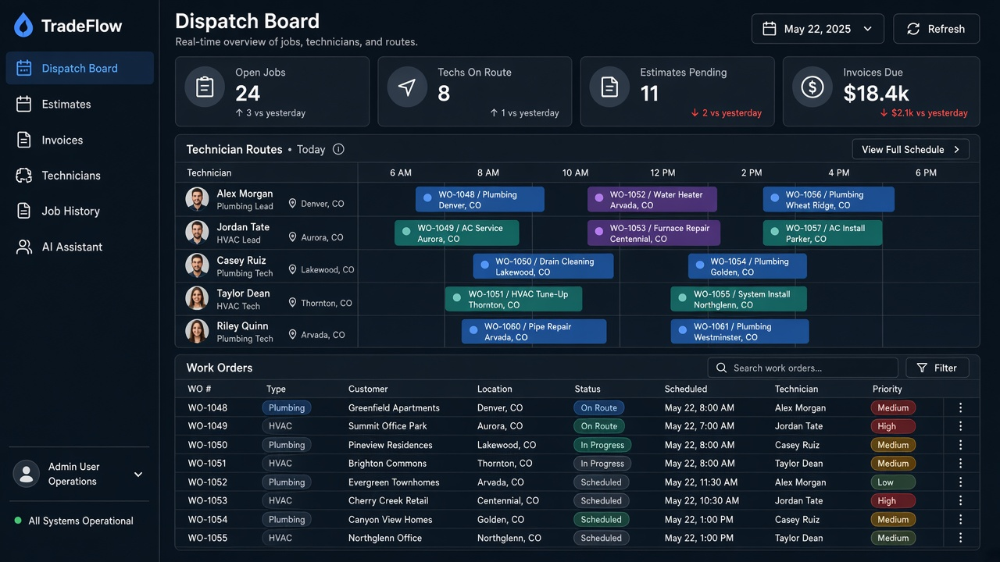

# Niche Payroll Compliance Tool



**SEO title:** Niche Payroll Compliance Tool | Overtime, Wage Classes, Filings & Jurisdiction Controls  
**SEO description:** Niche payroll compliance tool for overtime rules, wage classifications, filings, and jurisdiction-aware payroll controls that reduce compliance risk.  
**Keywords:** payroll compliance software, overtime rule engine, wage classification management, multi-jurisdiction payroll, FLSA overtime controls, payroll filing calendar, compliance alerts, Laravel Filament payroll, PayComply  
**Author:** Imran Ahmed <me@imrandev.bd> · [imrandev.bd](https://imrandev.bd)  
**Accent:** `#CA8A04` · **Industry:** Payroll / HR Compliance  
**Repository:** [github.com/imranbru99/niche-payroll-compliance-tool](https://github.com/imranbru99/niche-payroll-compliance-tool)

---

## Why this product exists

Payroll risk rarely fails in one place — it fails at the seams: overtime multipliers differ by state, wage classes drift from job duties, filings miss due dates, and auditors ask for evidence packs that live in five spreadsheets. Boutique PEOs and multi-state employers need a modular compliance control plane — not another generic HRIS checkbox.

**Niche Payroll Compliance Tool (PayComply)** is a complete Laravel + Filament business solution for overtime rules, wage classifications, filings, jurisdiction catalogs, payroll runs, PDF audit packs, and AI compliance alerts. Every module is toggleable so a single-state studio, multi-state employer, or enterprise shared-services team runs only what they need.

### Business ROI & time-saver case

| Bottleneck | Without PayComply | With PayComply | Typical savings |
|---|---|---|---|
| OT threshold lookup | State PDFs / tribal knowledge | Jurisdiction OT rule matrix | **20–40 min / payroll cycle** |
| Misclassification review | Ad-hoc manager email | Wage class + alert queue | **1–2 hrs / week / manager** |
| Filing chase | Calendar reminders in inbox | Due-date filings + late alerts | **1–3 days off late remits** |
| Audit evidence | Manual PDF stitching | Unicode PDF compliance packs | **2–4 hrs / audit request** |
| Multi-state onboarding | Re-key wage floors | Jurisdiction catalog + min wage | **45–90 min / new state** |
| Risk triage | End-of-quarter surprises | AI/open alert dashboard | **Earlier remediation** |

For a payroll team covering ~8 jurisdictions, reclaiming even **30 minutes per jurisdiction per week** plus earlier late-filing capture routinely unlocks **10–20+ hours/month** — before penalty avoidance on OT and withholding misses.

---

## Product screenshot

The admin dashboard (gold `#CA8A04` theme) surfaces open compliance alerts, filings in progress, open pay periods, and active jurisdictions — designed for payroll controllers and compliance managers, not generic CRM chrome.

---

## Core modules (all toggleable)

Every module can be enabled/disabled via `.env`, `config/modules.php`, or the **Modules** Filament resource (`module_settings` table). Disabled modules hide from navigation and refuse resource access.

| Module key | Label | What it does |
|---|---|---|
| `jurisdictions` | Jurisdictions | Country/state catalogs with authorities and minimum wage |
| `wage_classes` | Wage Classifications | Exempt/non-exempt classes, rates, pay frequencies |
| `overtime_rules` | Overtime Rules | Daily/weekly OT multipliers and jurisdiction overrides |
| `employees` | Employee Roster | Workers linked to wage class, jurisdiction, manager |
| `pay_periods` | Pay Periods & Runs | Pay calendars, payroll runs, OT/gross snapshots |
| `filings` | Compliance Filings | Tax/labor filings with due dates and confirmation codes |
| `alerts` | Compliance Alerts | OT breach, misclass, and late-filing risk alerts |
| `pdf_packs` | PDF Compliance Packs | Unicode-ready auditor / regulator evidence packs |
| `ai_assist` | AI Payroll Assist | AI hub wiring for classification and filing narratives |
| `catalog_scrape` | Labor Catalog Scraper | Optional AI catalog assist for wage-board libraries |
| `attendance_ops` | Attendance Bridge | Optional time-clock bridge into OT calculations |
| `speed_optimizer` | Drutogoti Speed Layer | Performance helpers for admin dashboards |

---

## Multi-role users

| Role | Access |
|---|---|
| Super Admin | Full control, modules, users, filings |
| Admin | Payroll office administration |
| Manager | Team oversight, alert triage, filing ownership |
| Staff | Day-to-day payroll runs & classifications |
| Client / Customer | Portal-only period/filing visibility |
| Demo | Seeded showcase user for evaluations |

### Demo credentials (after `db:seed`)

| User | Email | Password |
|---|---|---|
| Demo | `demo@paycomply.test` | `password` |
| Super Admin | `superadmin@paycomply.test` | `password` |
| Admin | `admin@paycomply.test` | `password` |
| Manager | `manager@paycomply.test` | `password` |
| Staff | `staff@paycomply.test` | `password` |
| Client | `client@paycomply.test` | `password` |

---

## Public marketing pages

| Route | Purpose |
|---|---|
| `/` | Hero + live module grid |
| `/features` | Feature deep-dive for payroll risk teams |
| `/modules` | Toggleable module catalog with ON/OFF status |
| `/pricing` | Studio / Growth / Enterprise framing |
| `/security` | Role gates & compliance accountability |
| `/demo` | Demo credentials CTA |
| `/admin` | Filament admin panel (PayComply) |
| `/portal` | Authenticated client compliance portal |

---

## Technical stack

- **PHP 8.4 / Laravel 13** application core  
- **Filament 5** admin panel (gold primary `#CA8A04`)  
- **Livewire** interactive admin UI  
- Modular services: `ModuleManager`, `OvertimeCalculator`, `FilingReminderService`  
- Policies for compliance filings  
- Migrations, models, seeders, feature tests  
- Dockerized (`Dockerfile` + `docker-compose.yml`) with MySQL  

### Packagist packages (`imrandevbd/*`)

| Package | Role in this product |
|---|---|
| `imrandevbd/drutogoti` | Performance / speed helpers |
| `imrandevbd/laravel-admin-panel` | Admin panel extensions |
| `imrandevbd/laravel-ai-catalog` | Catalog / enrichment patterns for wage boards |
| `imrandevbd/laravel-ai-hub` | Multi-provider AI for compliance alerts |
| `imrandevbd/laravel-attendance-hub` | Time-clock / attendance machine integration |
| `imrandevbd/laravel-unicode-pdf` | Multilingual compliance PDF packs |
| `imrandevbd/laravel-universal-slug` | Unicode-safe slugs for OT rules & PDF packs |

> **Note:** On Laravel 13, Packagist builds of `drutogoti`, `laravel-admin-panel`, and `laravel-attendance-hub` currently constrain `illuminate/*` to ^11|^12. This repo declares all seven packages at `dev-main` and ships L13 path compatibility bridges under `packages/` so the application installs cleanly while upstream catches up. `laravel-ai-hub`, `laravel-unicode-pdf`, and `laravel-universal-slug` install from Packagist. `laravel-ai-catalog` uses a local bridge because Packagist `dev-main` requires `laravel-ai-hub:^1.6` which conflicts with root `dev-main`.

---

## Quick start (local)

```bash
composer install
cp .env.example .env
php artisan key:generate
touch database/database.sqlite   # or configure MySQL
php artisan migrate --seed
php artisan serve
```

- Marketing site: [http://127.0.0.1:8000](http://127.0.0.1:8000)  
- Admin: [http://127.0.0.1:8000/admin](http://127.0.0.1:8000/admin)  

### Docker

```bash
docker compose up --build
```

App: [http://localhost:8080](http://localhost:8080) · MySQL published on host `3307`.

---

## Architecture highlights

```
app/
  Enums/UserRole.php
  Filament/Resources/{Jurisdictions,WageClassifications,OvertimeRules,PayrollEmployees,PayPeriods,PayrollRuns,ComplianceFilings,ComplianceAlerts,PdfCompliancePacks,ModuleSettings,Users}
  Filament/Widgets/{PayrollStatsOverview,ComplianceAlertsWidget}
  Models/{Jurisdiction,WageClassification,OvertimeRule,PayrollEmployee,PayPeriod,PayrollRun,ComplianceFiling,ComplianceAlert,PdfCompliancePack,ModuleSetting}
  Policies/ComplianceFilingPolicy.php
  Services/{ModuleManager,OvertimeCalculator,FilingReminderService}
  Http/Controllers/{MarketingController,PortalController}
config/modules.php
config/payroll.php
```

---

## Opportunities & roadmap ideas

- Certified payroll / prevailing wage packs  
- Collective bargaining agreement OT overlays  
- Multi-EIN / multi-brand consolidation  
- Bank / payroll provider export connectors  
- Worker self-service pay stub evidence locker  
- Predictive penalty exposure scoring  

---

## License & authorship

MIT-licensed portfolio application.  
**Author / committer:** Imran Ahmed <me@imrandev.bd> — [https://imrandev.bd](https://imrandev.bd)

---

## 🤝 Let's Connect & Collaborate

I am open to Senior Remote Full-Stack Roles, AI Platform Architecture Contracts, and Enterprise Technical Advisory.

Timezone: UTC+6 (Dhaka / Rangpur, Bangladesh) — Flexible overlap with US, UK, and European business hours.

Delivery Mode: Async-ready, Slack, Discord, Jira, GitHub, and production-first accountability.

| Channel | Address / Handle | Quick Action |
|---|---|---|
| 🌐 Primary Portfolio | [imrandev.bd](https://imrandev.bd) | [Visit Site ↗](https://imrandev.bd) |
| 📦 Packagist Packages | [packagist.org/packages/imrandevbd/](https://packagist.org/packages/imrandevbd/) | [View Packages ↗](https://packagist.org/packages/imrandevbd/) |
| 💼 LinkedIn Profile | [linkedin.com/in/imranbru99](https://linkedin.com/in/imranbru99) | [Connect ↗](https://linkedin.com/in/imranbru99) |
| 🐙 GitHub Profile | [github.com/imranbru99](https://github.com/imranbru99) | [Follow ↗](https://github.com/imranbru99) |
| 💬 WhatsApp Direct | +880 1576-918420 | [Chat Now ↗](https://wa.me/8801576918420) |
| 📧 Direct Email | me@imrandev.bd | [Send Email ↗](mailto:me@imrandev.bd) |
| 🐦 X (Twitter) | [@imrandev_bd](https://x.com/imrandev_bd) | [Follow ↗](https://x.com/imrandev_bd) |
| 📺 YouTube Tech | [@ImranDevBD](https://youtube.com/@ImranDevBD) | [Subscribe ↗](https://youtube.com/@ImranDevBD) |
